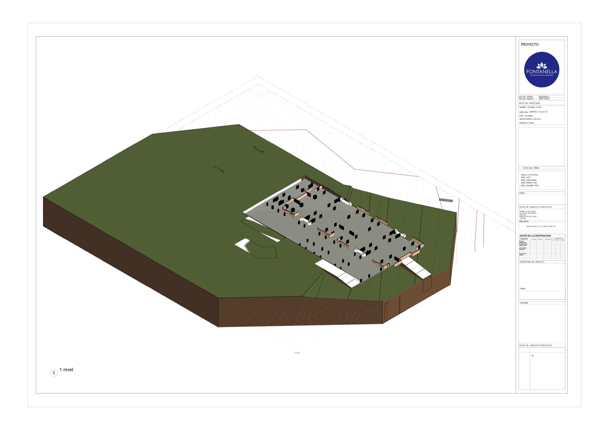

# Primer nivel (Nivel 1)

- **Archivo PDF original:** `nivel-01.pdf` (16.6 MB)
- **Tipo de lámina:** Plano en isometría (vista 3D) exportado de Revit, 1 página
- **Tamaño de lámina:** 2835 x 2004 pt (formato A0 aprox., horizontal)
- **Proyecto:** FONTANELLA - En armonía con la naturaleza
- **Uso del predio:** Residencial · **Tipo de trámite:** Obra nueva
- **Propietario:** Segunda Etapa
- **Dirección:** Carrera 2 Calle 63 · Tunja, Boyacá, Colombia
- **Arquitecto proyectista:** Víctor Vargas
- **Dibujante:** Grafica Tunja C.C. 450 Años, oficina 118
- **Contiene:** rótulo '1 nivel' · Hoja Revit n.º 51

## Imagen

> El cajetín incluye campos sin diligenciar (cédula catastral, áreas, firma, licencia, teléfono).
